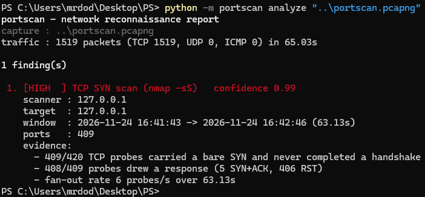

# PortScan

A small tool I built to learn what a port scan actually looks like and how python scripting can detect it.

I am early in my cybersecurity career. I realized that in school all I was given was that Nmap is a tool used to scan networks. I never got shown how to use it, or what it really does. That is why I decided to build this hands on project that allowed me to use Nmap and understand how the different flags perform different types of scans, while also giving me experience using python for detecting these types of security events. I got to see both sides, one was the attacker (the person performing the scan) and one being the defender (the person who detected the port scan using python).

## What it does

- Reads a packet capture (.pcap), I used Wireshark.
- Names the Nmap technique behind the traffic: SYN, connect, FIN, XMAS, NULL, ACK, Maimon, UDP, service/version detection, OS fingerprinting, host sweeps and horizontal sweeps.
- Says who scanned whom, over what time window, and how many ports were touched.
- Backs every verdict with the evidence and a confidence score instead of just a label.
- Tells probes apart from responses, so ordinary web browsing, DNS and service discovery are not reported as attacks.

## What it looks like

I ran a SYN scan against loopback, captured it in Wireshark and saved the traffic as a pcap.

```
nmap -sS -p 1-400,20001-20008 --min-rate 800 -Pn -n 127.0.0.1
```



*The report for the scan above.*

## What it's built with

Built using python with the DPKT library. The analysis is entirely rule-based, so every finding can be traced back to the packets that caused it. Give it a .pcap file that is obtained with a tool such as Wireshark. The code checks it against 25 different tests in order to properly label the scan.

## About this project

This is a personal learning project, not a product. The lab only ever scans loopback and private addresses, and it has never been pointed at a network I do not own. Scanning a network without written permission is illegal.
